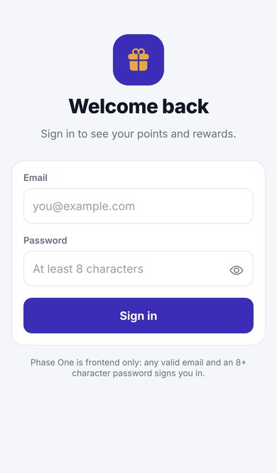
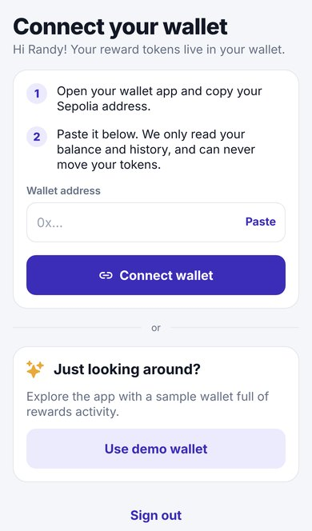
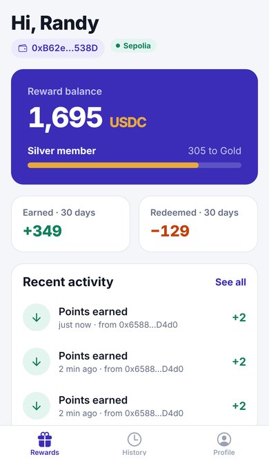
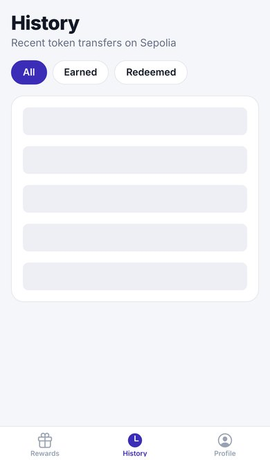
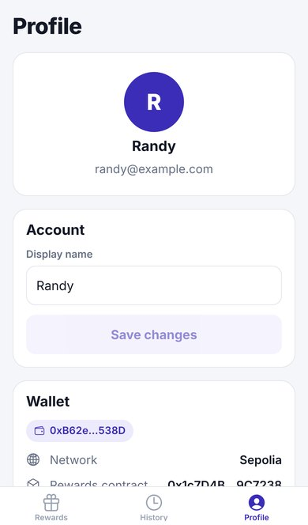
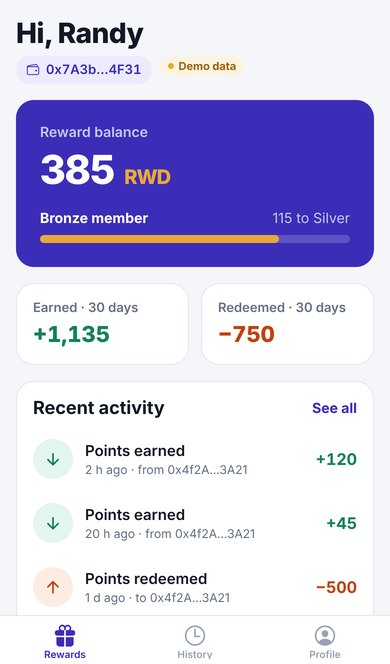
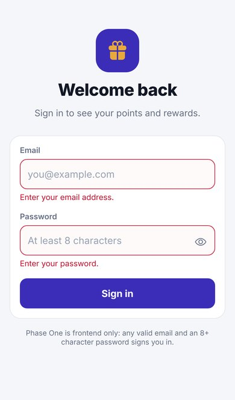
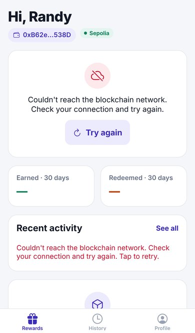

# Loyalty Rewards: Phase One demo

A cross-platform (iOS, Android and web) loyalty rewards app built with **React Native, Expo and TypeScript**. Users sign in, connect a wallet, and see their reward token balance, loyalty tier and transaction history, read straight from a deployed smart contract.

<p>
  
  
  
  
</p>
<p>
  
  
  
  
</p>

## Features

| Area | What it does |
| --- | --- |
| **Login** | Email and password form with validation that appears after the first submit and updates as you type; show/hide password; loading state. Frontend only for Phase One (a stand-in for the real auth API). |
| **Connect wallet** | Paste a wallet address (with a one-tap Paste button), validated including the EIP-55 checksum so typos are caught. Or explore with a demo wallet. Read-only, so the app can never move tokens. |
| **Rewards dashboard** | Token balance read with `balanceOf`, loyalty tier (Bronze / Silver / Gold / Platinum) with progress to the next tier, points earned and redeemed in the last 30 days, recent activity, and token details (`name`, `symbol`, `decimals`, `totalSupply`) read from the contract via its ABI. |
| **Transaction history** | Recent `Transfer` events for the wallet, labelled as earned (incoming) or redeemed (outgoing), grouped by day, with All / Earned / Redeemed filters. Each row opens the transaction on Etherscan. |
| **Profile** | Editable display name with validation, wallet and contract details, switch wallet, sign out. |
| **States** | Skeleton loaders, pull to refresh, friendly error messages with retry, and empty states on every screen. The session persists across app restarts. |

## Blockchain integration

Reads use [viem](https://viem.sh). Out of the box the app reads a **real deployed ERC-20 contract on the Sepolia test network** (Circle's test USDC) as a stand-in for the rewards token, so live mode works with any Sepolia wallet that holds it.

- **Contract reads via ABI:** [`src/lib/abi.ts`](src/lib/abi.ts) holds the ABI; [`src/lib/rewards.ts`](src/lib/rewards.ts) reads token info and balances with `readContract`.
- **Transaction history:** public RPC providers limit how many blocks one `eth_getLogs` request can cover, so history is fetched backwards in chunks, with separate filtered queries for incoming and outgoing transfers. It stops as soon as it has enough results, de-duplicates self-transfers, and attaches block timestamps. A failed timestamp lookup leaves that one time blank instead of failing the whole list.
- **Stale-response protection:** [`src/hooks/useAsync.ts`](src/hooks/useAsync.ts) tags every result with the request that produced it, so a slow, outdated response can never overwrite newer data (for example after switching wallets).
- **Live or demo data:** both implement one `RewardsSource` interface ([`src/lib/types.ts`](src/lib/types.ts)), so screens don't care where data comes from, and a backend API can slot in the same way in a later phase.

### Pointing it at your contract

Everything is in [`src/config.ts`](src/config.ts), or set environment variables:

```bash
EXPO_PUBLIC_REWARDS_TOKEN=0xYourRewardsToken
EXPO_PUBLIC_RPC_URL=https://your-rpc-provider
```

To use a different network, change `CHAIN` in `src/config.ts` (any chain from `viem/chains`). For custom contract functions (for example `pointsOf` or `tierOf`), add them to `src/lib/abi.ts` and read them in `src/lib/rewards.ts`.

### Connecting wallets with WalletConnect

Every Phase One feature is a read, so a validated address is all the app needs. To let users connect with a wallet app instead of pasting an address, add Reown AppKit (WalletConnect) with a project ID from cloud.reown.com. It only needs to supply an address to the existing `connectWallet()` in [`src/state/session.tsx`](src/state/session.tsx). Nothing else changes.

## Run it

Requires Node 20+.

```bash
npm install
npm start          # then press i (iOS simulator), a (Android emulator) or w (web),
                   # or scan the QR code with Expo Go on a phone
```

Sign in with any valid email and an 8+ character password. Then tap **Use demo wallet**, or paste a Sepolia address that holds test USDC.

## Checks

```bash
npm run typecheck  # TypeScript, strict mode
npm run lint       # ESLint (Expo config)
npm test           # 26 unit tests: formatting, validation, contract reads, chunked history
npm run test:live  # end-to-end read of the real Sepolia contract (needs internet)
```

## Build for the stores

The app uses Expo's cloud builds, so no local Xcode or Android Studio is needed:

```bash
npx eas-cli@latest build --platform all      # signed iOS and Android builds
npx eas-cli@latest submit --platform all     # upload to App Store Connect and Google Play
```

Before submitting, set your own `ios.bundleIdentifier` and `android.package` in `app.json` (they are placeholders).

## Project structure

```
src/
  app/                    Screens (Expo Router: each file is a route)
    _layout.tsx           Root stack; routes guarded by sign-in and wallet state
    login.tsx
    connect-wallet.tsx
    (tabs)/               Rewards dashboard, History, Profile
  components/             Shared UI: buttons, fields, cards, skeletons, error/empty states, tx row
  hooks/useAsync.ts       Loading / refreshing / error state for any async load
  lib/
    abi.ts                Contract ABI
    rewards.ts            Live blockchain reads (viem)
    demo.ts               Built-in sample data
    format.ts             Exact bigint token formatting, tiers, friendly errors
    validation.ts         Login, display name and wallet address validation
  state/session.tsx       Signed-in user and wallet, persisted on device
  config.ts               Network, RPC and contract settings
__tests__/                Unit tests
__integration__/          Live network test
```
